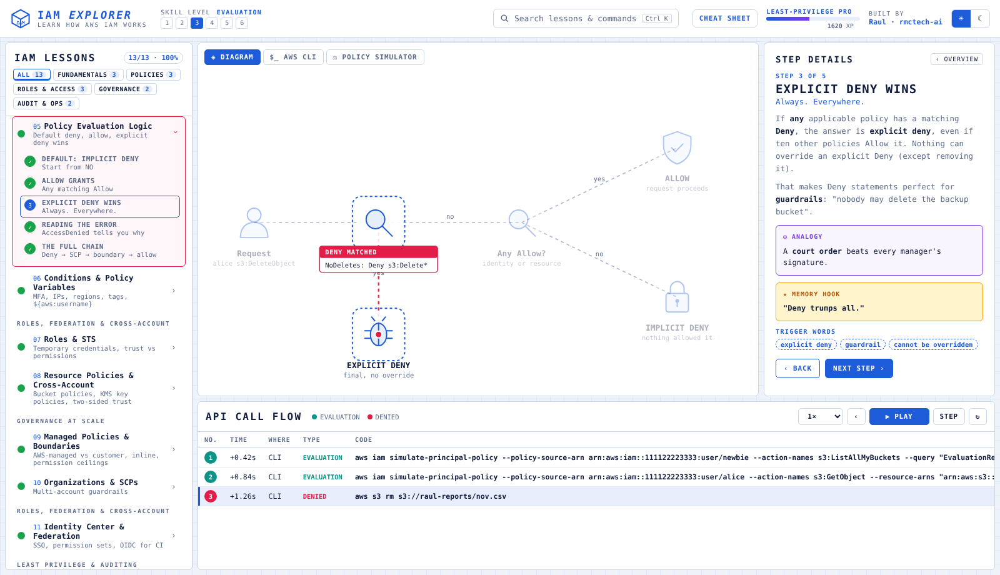

# 🔐 IAM Explorer — learn how AWS IAM works

An interactive, step-by-step course on **AWS Identity and Access Management** for Cloud Engineers heading toward **Cloud Security / IAM** roles. Every lesson animates how a request flows through AWS's authorization engine, with analogies, memory hooks, trigger words, quizzes, and a **real policy simulator lab** that evaluates your policies with AWS's evaluation logic (explicit deny → SCP → permissions boundary → identity/resource allow → implicit deny).

> Created by **Raul** ([@rmctech-ai](https://github.com/rmctech-ai)) · Freelance AI Automation Specialist on the path to Cloud Security.
> Part of the Explorer series: [Linux Explorer](https://github.com/rmctech-ai/linux-explorer) · [Python Explorer](https://github.com/rmctech-ai/python-explorer) · [VPC Explorer](https://github.com/rmctech-ai/vpc-explorer) · [IaC Explorer](https://github.com/rmctech-ai/iac-explorer) · [Serverless Explorer](https://github.com/rmctech-ai/serverless-explorer) · [CI/CD Explorer](https://github.com/rmctech-ai/cicd-explorer) · [Cloud Security Explorer](https://github.com/rmctech-ai/cloudsecurity-explorer).
> Layout framework inspired by [Protocol Explorer](https://protocol-explorer-alpha.vercel.app/) by Dilum Sanjaya.



---

## ▶ Run it

No build step. Plain HTML/CSS/JS.

```bash
python3 -m http.server 8000     # then open http://localhost:8000
```

### Publish on GitHub Pages
```bash
git init && git add . && git commit -m "IAM Explorer"
git branch -M main
git remote add origin https://github.com/rmctech-ai/iam-explorer.git
git push -u origin main
```
GitHub → **Settings → Pages → Deploy from a branch → `main` / root → Save** → `https://rmctech-ai.github.io/iam-explorer/`

---

## 🧭 How to use it

| Area | What it does |
|---|---|
| **Lessons** (left) | 13 lessons grouped by track. Click to expand steps. Dots show progress. |
| **Diagram** tab | Animated scene for every step. |
| **$_ AWS CLI** tab | Types out real commands/code for the step with realistic output. |
| **⚖ POLICY SIMULATOR** tab | **Policy Simulator**: write identity, resource or trust policies in JSON, fire test requests (principal, action, resource, context keys like MFA or source IP) and see ALLOW / EXPLICIT DENY / IMPLICIT DENY with a statement-by-statement trace. Challenges ship fixed SCPs and boundaries and auto-check your policy against test requests. |
| **Step Details** (right) | Explanation, **Analogy**, **Memory Hook**, **Trigger Words**, real-world notes, warnings. |
| **Api Call Flow** (bottom) | Log of every command so far with type, output and status. |
| **XP & levels** | Earn XP for steps, lessons, quizzes and challenges. Saved in your browser. |
| **Cheat Sheet** | Master hooks + key syntax for every lesson (also [`CHEATSHEET.md`](CHEATSHEET.md)). |

**Keyboard:** `→` / `←` steps · `Space` play · `Ctrl+K` search · `Esc` close.

---

## 📚 Curriculum (13 lessons · 65 steps · 52 quiz questions · 8 hands-on challenges)

| # | Lesson | Track | You'll learn |
|---|---|---|---|
| 01 | What is IAM? | FUNDAMENTALS | Who can do what, on which resource |
| 02 | The Root User | FUNDAMENTALS | Lock down the master key |
| 03 | Users, Groups & Credentials | FUNDAMENTALS | Long-term identities and their risks |
| 04 | Policy Anatomy ⚑ | POLICIES | Effect · Action · Resource · Condition |
| 05 | Policy Evaluation Logic ⚑ | POLICIES | Default deny, allow, explicit deny wins |
| 06 | Conditions & Policy Variables ⚑ | POLICIES | MFA, IPs, regions, tags, ${aws:username} |
| 07 | Roles & STS ⚑ | ROLES & ACCESS | Temporary credentials, trust vs permissions |
| 08 | Resource Policies & Cross-Account ⚑ | ROLES & ACCESS | Bucket policies, KMS key policies, two-sided trust |
| 09 | Managed Policies & Boundaries ⚑ | GOVERNANCE | AWS-managed vs customer, inline, permission ceilings |
| 10 | Organizations & SCPs ⚑ | GOVERNANCE | Multi-account guardrails |
| 11 | Identity Center & Federation | ROLES & ACCESS | SSO, permission sets, OIDC for CI |
| 12 | Least Privilege Toolkit ⚑ | AUDIT & OPS | Access Analyzer, last accessed, policy generation |
| 13 | Auditing with CloudTrail | AUDIT & OPS | Who did what, when, from where |

⚑ = has a hands-on challenge.

## 🎯 Study plan & capstone

- **Week 1:** Lessons 1–6 (fundamentals, policy anatomy, evaluation logic, conditions). Solve every simulator challenge.
- **Week 2:** Lessons 7–10 (roles & STS, resource policies & cross-account, boundaries, SCPs).
- **Week 3:** Lessons 11–13 (Identity Center, least-privilege tooling, CloudTrail auditing).

**Capstone:** In a free-tier AWS account: enable MFA on root, create an Identity Center admin + a developer permission set, give a Lambda a least-privilege execution role, restrict regions with an SCP (if you use Organizations), and write a CloudTrail-based report of AccessDenied events. Document it in a GitHub repo.

## License
MIT © 2026 Raul (rmctech-ai)
